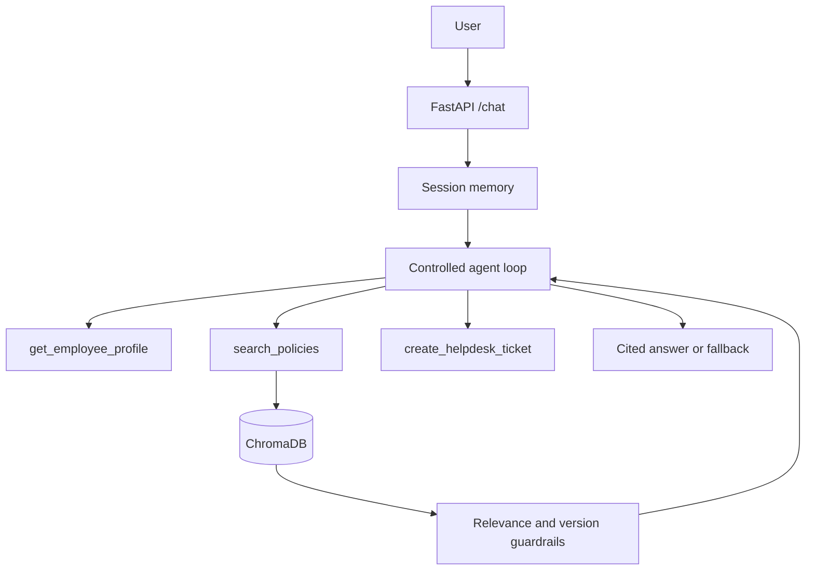

# HR & IT Helpdesk Agent — Document Q&A Assistant

> **Assessment implementation starter.** The assessment panel has not supplied the original `/data` knowledge base or employee records. The included policy files and employee records are clearly labelled sample data, not official company policy. Replace them with the panel-provided files before representing outputs as company answers.

## Features
- PDF and Markdown ingestion with page/section metadata.
- ChromaDB vector index with deterministic chunk IDs for idempotent ingestion.
- Employee profile lookup, policy search and explicit-request-only ticket creation.
- FastAPI `POST /chat`, session memory, country clarification, citations and confidence flags.
- Five-tool-call ceiling and conservative fallback.
- Automated tests for the five mandatory behaviours.

## Architecture



Ingestion: files in `data/` -> PDF page / Markdown section extraction -> structure-aware chunks -> embeddings -> ChromaDB with source, page/section, country, document type, effective date and deterministic ID.

## Setup

Python 3.11 is recommended.

```bash
python -m venv .venv
# Windows:
.venv\Scripts\activate
# macOS/Linux:
source .venv/bin/activate

pip install -r requirements.txt
copy .env.example .env   # Windows
# cp .env.example .env   # macOS/Linux
```

Set `OPENAI_API_KEY` in `.env` to enable LLM answer generation. Never commit `.env`.
The embedding model downloads on first use.

## Add the official assessment files

Copy the six panel-provided documents into `data/` and place the supplied `employees.json` in the project root (or set `EMPLOYEES_FILE`). Remove the sample policies before indexing. Preserve exact source filenames where possible.

## Ingest and run

```bash
python -m app.ingestion --reset
uvicorn app.main:app --reload
```

Health check: `GET http://127.0.0.1:8000/health`

## API

```bash
curl -X POST http://127.0.0.1:8000/chat ^
  -H "Content-Type: application/json" ^
  -d "{\"message\":\"How many leave days can I carry forward?\",\"employee_id\":\"E102\",\"session_id\":\"s1\"}"
```

Example two-turn clarification:

```bash
curl -X POST http://127.0.0.1:8000/chat -H "Content-Type: application/json" -d "{\"message\":\"What travel allowance can I claim?\",\"session_id\":\"trip1\"}"
curl -X POST http://127.0.0.1:8000/chat -H "Content-Type: application/json" -d "{\"message\":\"I'm in Sri Lanka\",\"session_id\":\"trip1\"}"
```

Ticket request example:

```bash
curl -X POST http://127.0.0.1:8000/chat -H "Content-Type: application/json" -d "{\"message\":\"My laptop screen is broken, please raise a ticket\",\"employee_id\":\"E102\",\"session_id\":\"ticket1\"}"
```

Response shape:
`answer`, `sources`, `confidence_flag` (`high|partial|low`), `tool_calls`, `ticket_id`.

## Tool-call traces (illustrative)

1. Single-document leave question: `get_employee_profile(E102)` -> `search_policies(leave carry forward, India, leave)` -> cited answer.
2. Colombo business-trip question: `get_employee_profile(E102)` -> `search_policies(leave approval, India, leave)` -> `search_policies(Colombo business travel, Sri Lanka, travel)` -> combined cited answer. (The exact approval rules depend on official source documents.)
3. Password reset: `search_policies(password reset, no country, it)` -> answer citing `it-helpdesk-faq.md`, Password Reset.

## Threshold choice

The initial threshold is `0.70` (configurable through `SIMILARITY_THRESHOLD`). This is a starting value, not a universal constant. Calibrate it against labelled in-scope paraphrases and out-of-scope queries. Plot/inspect relevant and irrelevant score distributions, choose a threshold that meets the desired precision/recall trade-off, then regression-test known valid and out-of-scope questions. The implementation converts Chroma distance to a bounded score as `1 / (1 + distance)`; validate this calibration for the selected embedding and distance metric.

## Scenario analysis

1. **Hallucination:** the model supplements sparse context with parametric knowledge. Use a strict context-only prompt, temperature 0, and answer-support validation; test by asking for an unsupported payout detail when the source only states a five-day cap.
2. **Valid question falls back:** inspect ingestion, extracted text, chunk boundaries, embedding/query model compatibility, filters, top-k and score calculation in that order. Calibrate threshold with labelled in-scope paraphrases and out-of-scope queries; add reranking/hybrid search if needed.
3. **Out-of-scope answered:** retrieval relevance was not enforced or the LLM answered from prior knowledge. Require relevant retrieved evidence before generation; return fallback without calling the LLM if no chunk passes.
4. **Wrong citation:** source metadata may have been detached from chunk text or citations generated by the LLM. Keep metadata attached to each Document and construct sources only from retrieved chunk metadata; test expected source/page.
5. **Steps split across chunks:** tiny character chunks separated a procedural sequence. Use heading/step-aware chunking, larger chunks and overlap; retrieve adjacent chunks when a step sequence spans boundaries.
6. **Search loop:** the agent lacks a useful stopping criterion and repeats semantically similar searches. Track normalized query history, cap calls at five, stop after repeated low-relevance results, and fall back when no new evidence is found.
7. **Unrequested action:** the model inferred action intent from a problem statement. Gate ticket creation with explicit user-request detection and application-side authorization; test that informational wording leaves `tickets.json` unchanged.

## Tests

```bash
pytest -q
```

The included tests use mocked retrieval and LLM output, so they do not require API credentials or model downloads. Add integration tests against the real vector store after inserting the official data.

## AI coding tools disclosure

If submitting this project, accurately disclose the tools used. Suggested wording, only if true:

"ChatGPT was used to help draft the project structure, implementation examples, documentation and test scenarios. I reviewed and adapted the generated material and remain responsible for validating and explaining the code."

Do not claim independent authorship of work you have not reviewed. Be prepared to explain each module and run the tests live.
